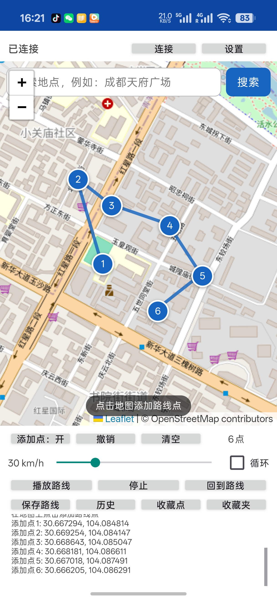
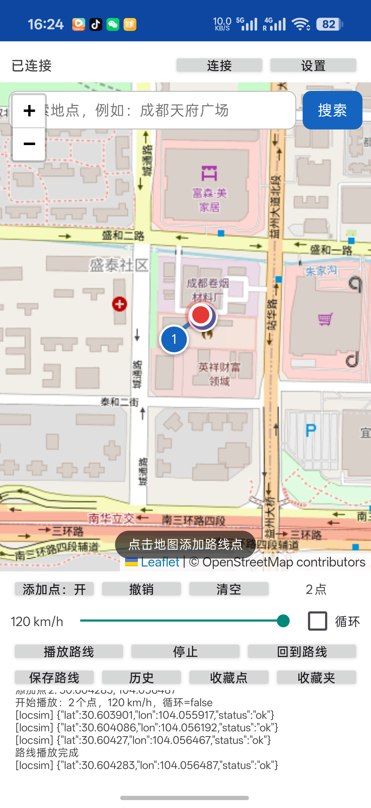

# iOS 定位模拟器（Android OTG 独立版）

Android 手机通过 OTG 直连 iPhone，**不需要电脑、不需要越狱、不需要在 iPhone 上安装 App**。
已验证设备：iPhone 17 Pro（`iPhone18,3`，iOS 27.0.1）+ OPPO PKX110（Android 17）。

## 原理

iPhone 的 USB 接口只暴露 usbmux 多路复用协议。桌面上由 Apple usbmuxd 把它翻译成
普通 TCP；Android 没有这个守护进程，所以本 App 内置了一个：

```text
App 内 go-ios 进程
   │  TCP 127.0.0.1:27015（标准 usbmuxd 客户端协议）
   ▼
UsbMuxDaemon.kt（本 App 实现）
   │  UsbMuxTransport.kt（usbmux v2 over USB bulk）
   ▼
iPhone
   │  lockdown 配对
   │  com.apple.internal.devicecompute.CoreDeviceProxy → userspace 隧道
   │  RSD / RemoteXPC
   └─ DVT com.apple.instruments.server.services.LocationSimulation
```

go-ios 负责配对、隧道、RSD、DVT；App 只负责“USB → 本地 usbmuxd”这一层。
iOS 17+ 已不再提供 `com.apple.dt.simulatelocation`，所以这里走的是 DVT 的
`LocationSimulation` 通道。

## 关键实现点

- **USB configuration 切换**：Apple 的 usbmux 接口（class `0xFF`/sub `0xFE`/proto `2`）
  不在默认 configuration 里。必须先 `UsbDeviceConnection.setConfiguration()`
  切到包含该接口的 configuration（本机为 id=3），否则 `claimInterface` 全部失败。
- **端口字节序**：usbmuxd 的 `PortNumber` 是网络字节序。go-ios 的
  `Lockdownport = 32498`，即 `ntohs(32498) == 62078`；App 在
  `UsbMuxDaemon.handleConnect()` 里做 `ntohs` 后再调用 `UsbMuxTransport.connect()`。
- **配对记录**：App 私有目录 `files/pair/<UDID>.plist`，由 usbmuxd 的
  `SavePairRecord` / `ReadPairRecord` 管理。
- **go-ios 二进制**：`app/src/main/jniLibs/arm64-v8a/libgoios.so`，是
  `GOOS=linux GOARCH=arm64 CGO_ENABLED=0` 编译的 **ET_EXEC** 静态二进制
  （不要用 PIE；Android 的 Bionic linker 会因 TLS 对齐报错）。
- **tunnel-info host**：go-ios 的 `tunnel start` / `setlocation` 必须带
  `--tunnel-info-host=127.0.0.1`，否则 Android 上 `localhost` 可能解析到 `::1`，
  `setlocation` 找不到隧道信息而回退到已移除的 `simulatelocation` 服务。

## 使用

1. iPhone 用 **OTG 转接头**接到 Android 手机（USB-C 直连 C-to-C 可能让 iPhone
   反过来当主机，建议用 OTG）。
2. iPhone 解锁；首次连接时点“信任此电脑”并输入锁屏密码。
3. iPhone 设置 → 隐私与安全性 → **开发者模式**：打开并重启确认。
4. 打开 App，允许 USB 权限，点右上角 **连接**；首次连接在 iPhone 上点“信任”。
5. 状态变成“已连接”后，在主界面地图上选点、播放路线、保存/收藏（见下）。
6. **停止** 会结束 DVT 会话；若仍显示模拟位置，重启 iPhone 即可恢复。

> 当前版本需要保持 App 在前台（屏幕常亮）。切后台/被杀后定位会话会断开。

## 路线与地图

主界面是 Leaflet 地图 + 路线面板：

- **地图源**：默认 OpenStreetMap；右上角“设置”可切到自定义 XYZ 瓦片并填写自己的
  API Key，URL 里的 `{key}` 会替换成 Key，支持 MapTiler、Thunderforest 等。
  示例模板：`https://api.maptiler.com/maps/streets-v2/{z}/{x}/{y}.png?key={key}`。
- **选点**：点“添加点：开”后在地图上点击，编号标记 + 折线实时显示；“撤销/清空”编辑。
- **路线播放**：按速度（km/h）沿折线插值，默认每 1 秒更新一次，支持循环。
  `liblocsim.so` 保持同一个 DVT `LocationSimulation` 会话，每次 tick 写入
  `S lat lon`，不会每个点重启一次 `go-ios setlocation`。
- **保存/历史**：路线存 SharedPreferences（名称、点、时间），可加载、长按删除。
- **收藏点/收藏夹**：保存常用坐标；点击加入路线，长按删除。
- **坐标系**：地图点击使用 WGS-84，和 iPhone GPS 一致；不要把 GCJ-02 瓦片
  （高德/腾讯）直接叠在 WGS-84 坐标上，会有几百米偏移。

## 界面





## 已验证

- App 内 usbmuxd 能让 go-ios 看到 UDID：`{"deviceList":["00008150-XXXXXXXXXXXX"]}`（UDID 已脱敏）
- `go-ios pair` 成功（iPhone 显示信任）
- CoreDeviceProxy 用户态隧道建立（`grantedMtu=1280`）
- DVT 设置成都 `30.572815, 104.066800`，iPhone 指南针确认生效
- 地图选点 6 点、折线显示、缩放/平移正常
- 2 点路线以 120 km/h 平滑播放完成（`locsim` 每秒返回 `status:ok`）
- 保存路线 → 历史列表可加载；收藏点 → 收藏夹可加入路线

## 限制 / 后续

- **前台服务**：还没做，App 切后台可能被系统杀掉；下一步用
  `ForegroundService` 托管 `UsbMuxDaemon` + go-ios 进程。
- **路线编辑**：支持添加/撤销/清空，但还没做点拖动重排、GPX 导入；
  路线播放时不要旋转/重建 Activity（点列表保存在内存里）。
- **地图瓦片**：默认 OSM 依赖网络，国内可能较慢；在“设置”里填自己的
  MapTiler/Thunderforest API Key 或自定义 XYZ 源即可。搜索用 Nominatim。
- **iOS 17.0–17.3**：go-ios 的 userspace 隧道只支持 17.4+；17.0–17.3 需要
  NCM + RemotePairing/QUIC 路径，本 App 未实现。
- **DDI**：本机 iOS 27 的 DVT 直接可用；若某些 iOS 版本提示需要开发者镜像，
  需要额外做 DDI/个性化挂载。

## 构建

- JDK 17（Android Studio 的 JBR 25 与 Gradle 8.9 不兼容）。
- Android SDK Platform 34、Build-Tools 34。
- `./gradlew assembleDebug --offline`（依赖已缓存时）。
- go-ios 源码：`github.com/danielpaulus/go-ios`（MIT），编译：

```bash
GOOS=linux GOARCH=arm64 CGO_ENABLED=0 GOWORK=off \
  go build -o libgoios.so .
```

放到 `app/src/main/jniLibs/arm64-v8a/libgoios.so`，Gradle 会随 APK 打包并在
`nativeLibraryDir` 解压为可执行文件。

路线播放用的 `locsim` 源码在 `go/locsim/`（保持一个 DVT 会话，从 stdin 读
`S lat lon`）：

```bash
cd go/locsim
GOOS=linux GOARCH=arm64 CGO_ENABLED=0 GOWORK=off go build \
  -o ../../app/src/main/jniLibs/arm64-v8a/liblocsim.so .
```

> `liblocsim.so` 也必须是 ET_EXEC（不要 `-buildmode=pie`），否则 Android 的
> Bionic linker 会因 TLS 对齐报错。

## 参考

- go-ios：https://github.com/danielpaulus/go-ios
- usbmuxd 协议：https://github.com/libimobiledevice/usbmuxd
- DVT LocationSimulation：`com.apple.instruments.server.services.LocationSimulation`

仅用于开发与测试。虚拟定位可能违反部分服务的用户协议，使用后果自负。
